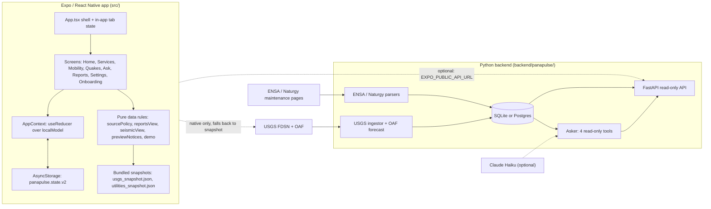
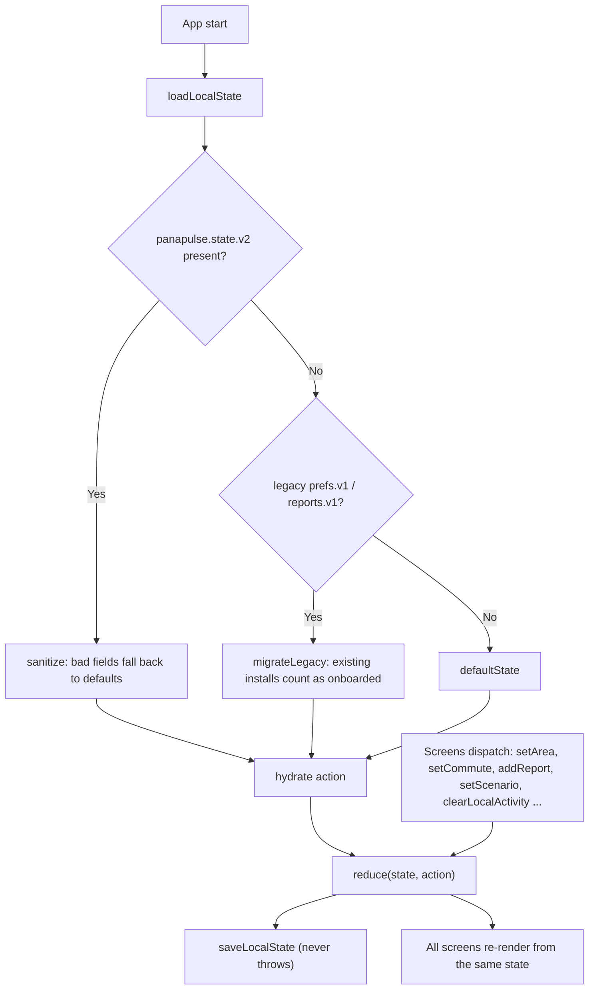
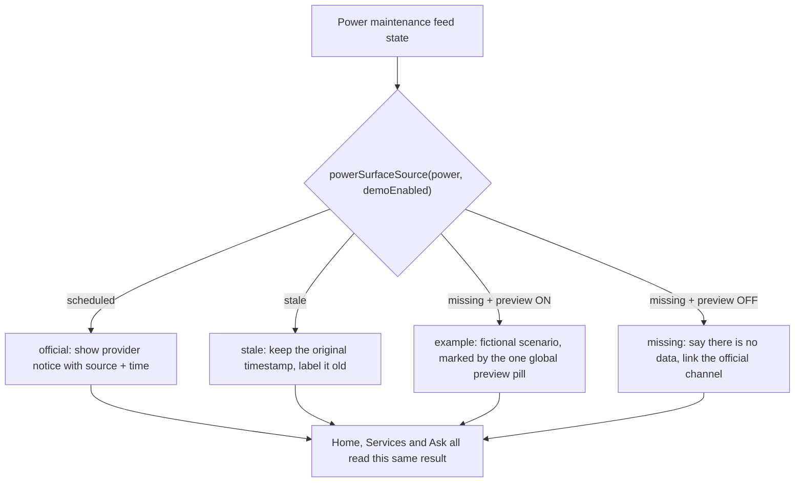
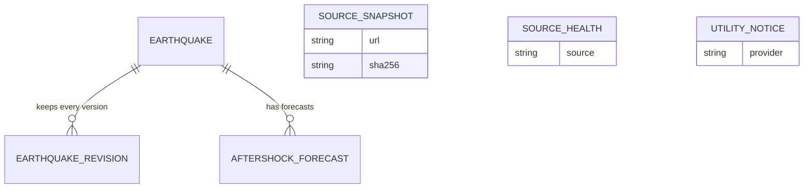
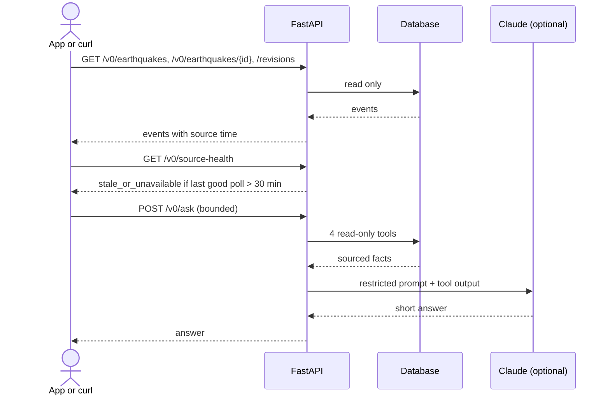
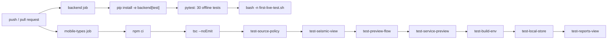

# PanaPulse | Proof of Concept (no deployment required)

**Baseline:** `main` as of October 20, 2026. **Status:** a working, tested proof of concept that runs on a laptop. It is **not** a deployed service, not a device-verified Beta 1 and not an app-store release.

This page is the front door. It says what the project is, what you can run and verify with nothing deployed, how the pieces fit (diagrams render natively on GitHub), and where the honest limits are. For deeper provenance and navigation diagrams see [`docs/architecture/PANAPULSE_TECHNICAL_ARCHITECTURE.md`](architecture/PANAPULSE_TECHNICAL_ARCHITECTURE.md) (linked, not duplicated).

## 1. What it is

A Spanish-first, bilingual (ES/EN) civic dashboard for Panama City: USGS earthquakes and aftershock forecasts, scheduled power maintenance notices, water and transit status, anonymous neighborhood reports and a guardrailed assistant. The design rule that shapes everything: **never present something as official, current or real unless it is**. Every data surface keeps three separate dimensions (operational state, verification, freshness) and fictional content only ever appears inside a clearly marked preview.

## 2. Prove it in five minutes, offline

| Step | Command | What it proves |
|---|---|---|
| Typecheck the app | `node --stack-size=8000 node_modules/typescript/bin/tsc --noEmit` | Expo SDK 57 / RN 0.86 / TS 6 code is type-sound |
| Run the app regression scripts | `for f in scripts/test-*.cjs; do node $f; done` | 7 scripts: source precedence, preview flow, service notices, seismic filters, local store, reports view, build-env guard |
| Run the backend tests | `cd backend && pip install -e '.[test]' && python -m pytest tests -q` | 30 offline tests: USGS normalization and revisions, utility parsers, `/v0/ask` guardrails |
| Run the app | `npm install && npx expo start --web` (or `npm run export:web`) | The full UI on web via react-native-web, in preview mode with fictional scenarios |
| Run the API | `cd backend && uvicorn panapulse.api:app` after `python -m panapulse.cli init-db` | Read-only FastAPI over a local SQLite DB |

All of the above run on fixtures and bundled snapshots. None needs the internet, an API key, a server or an Android device. CI repeats the same checks on every push (section 7).

## 3. How the pieces fit

Solid lines run in the proof of concept today. Dotted lines are optional runtime links that are **not** required and **not** claimed as deployed.

## 4. Local state: one typed model behind every screen

Every screen reads and writes the same reducer (`src/data/localModel.ts`), persisted under one versioned key (`src/state/persist.ts`). Changing area, scenario, a report or the saved commute updates every screen at once and survives a restart.

Rules enforced and tested in `scripts/test-local-store.cjs`: unknown areas are rejected, report notes are scrubbed of emails and phone numbers, reports are capped, preview-written reports carry `scope: 'preview'` so they never leak into live mode, and clearing local activity does not reset onboarding or settings.

## 5. Real vs preview: the decision the app makes on every power surface

An example can fill an empty slot. It can never replace a real current or stale official notice. This is covered by `scripts/test-source-policy.cjs` and `scripts/test-preview-flow.cjs`. USGS earthquake records are always real (live or timestamped snapshot), even with preview on.

## 6. Backend data model and read-only API

Tables (`backend/panapulse/models.py`): `source_snapshots`, `earthquakes`, `earthquake_revisions`, `aftershock_forecasts`, `source_health`, `utility_notices`. Revisions are immutable and an older fetch cannot overwrite a newer update. Only revisions and forecasts have a foreign key to `earthquakes`; snapshots, source health and utility notices stand alone. Attributes shown are a subset, check the model file for exact columns.

Also served: `GET /v0/forecast`, `GET /v0/power-maintenance`, `GET /healthz` (process liveness only, not data freshness). There is no public ingestion endpoint. The chat is limited to 400 input characters, a 6-turn window, per-client and global daily caps and 4 tool rounds.

## 7. How the proof is kept honest: CI

Workflow: `.github/workflows/ci.yml`. A green run means the offline behavior above holds. It says nothing about live providers.

## 8. Verified vs not verified

| Area | State | Evidence |
|---|---|---|
| Typed local state, persistence, migration | Implemented and tested | `scripts/test-local-store.cjs` |
| Source-first precedence (real never hidden by example) | Implemented and tested | `scripts/test-source-policy.cjs`, `test-preview-flow.cjs` |
| Preview scenarios (everyday, disruption, recovery) | Implemented, fictional by design | `docs/DEMO_MODE.md`, `scripts/test-service-preview.cjs` |
| Reports: feed, filters, details, delete, honest live empty state | Implemented, device-local only | `scripts/test-reports-view.cjs` |
| USGS ingest, revisions, OAF handling | Implemented, tested on fixtures | `backend/tests/test_usgs.py` |
| ENSA / Naturgy parsers | Implemented, tested on fixtures | `backend/tests/test_utilities.py` |
| Chat guardrails and read-only tools | Implemented, tested offline | `backend/tests/test_ask.py`, `src/chat/tools.ts` |
| UI in ES/EN, light/dark, 360/393 widths | Captured on **web** (react-native-web) | `design/review/` (files marked `_WEB`) |
| Live USGS / ENSA / Naturgy against real endpoints | **Not verified** in this environment | `docs/FIRST_LIVE_PILOT.md`, `scripts/first-live-test.sh` |
| Native Android/iOS device behavior | **Not verified** | `docs/BETA1_READINESS.md` |
| Hosted API, public reports, Metro/MiBus/IDAAN live data | **Not built or not connected** | `docs/DATA_SOURCES.md` |

Not an earthquake early-warning system. No predictions. A missing feed is never shown as "all clear".

## 9. Not on `main`

An unmerged branch, `codex/connected-web-beta-20261021`, explores a connected web beta (persisted anonymous reports on the backend, connected HTTP CI, a `vercel.json`). It is not part of this proof of concept and nothing here depends on it.

## Keeping this current

Update the diagrams in the same PR as any change to navigation, the local model, source precedence, the backend schema or CI. Verify against `src/data/localModel.ts`, `src/data/sourcePolicy.ts`, `backend/panapulse/models.py` and `.github/workflows/ci.yml` before trusting a diagram.
