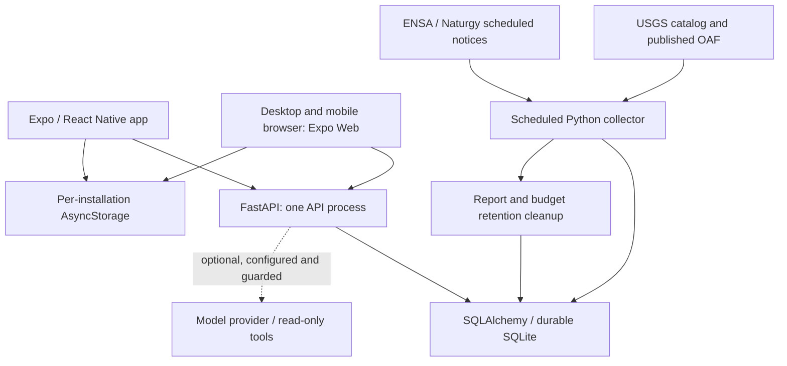
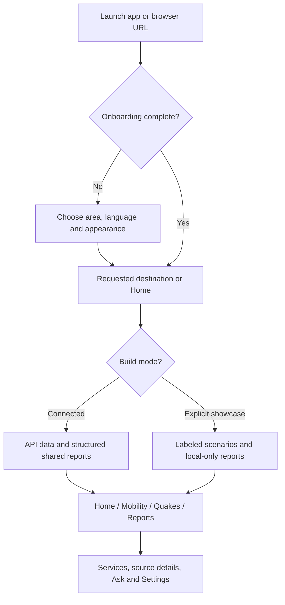
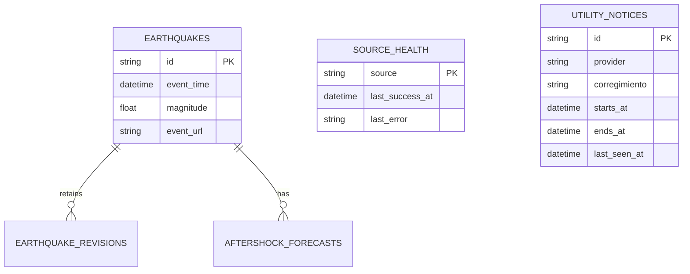
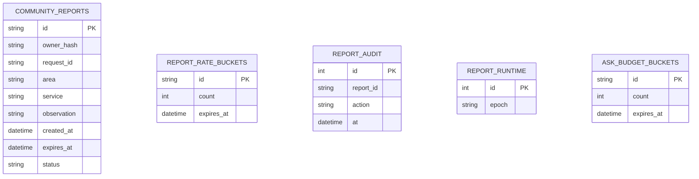
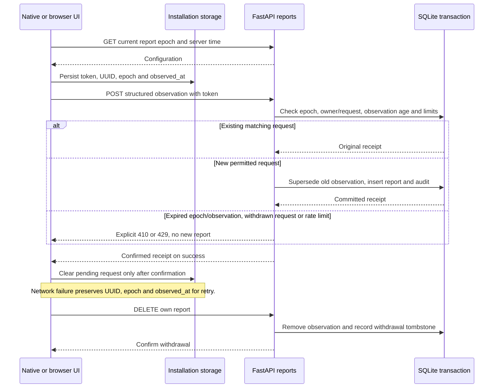
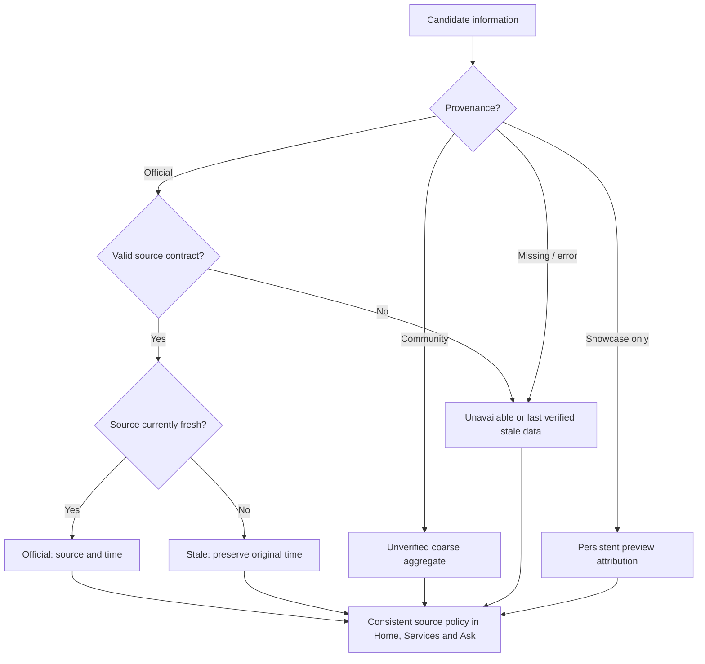
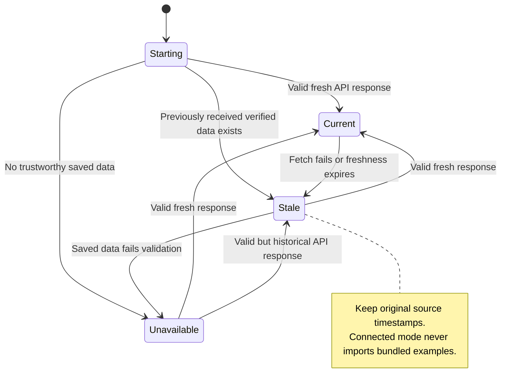
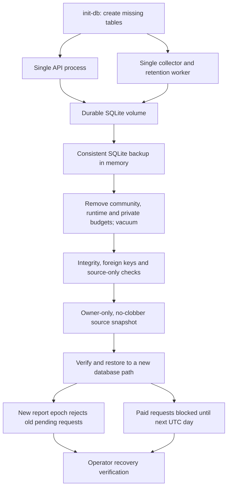
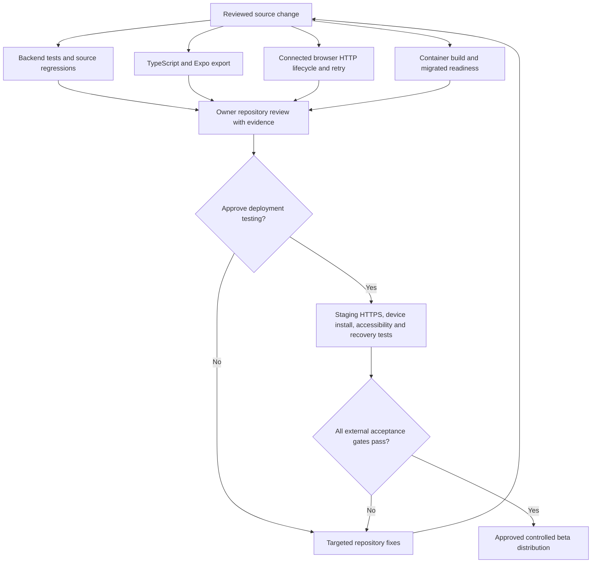

# PanaPulse | Technical Architecture & Product Flows

**Updated:** October 21, 2026. **Scope:** the connected implementation under review, preserving Expo / React Native, FastAPI, SQLAlchemy and Porcelana. These diagrams describe repository behavior, not a deployed service or completed native-device acceptance.

The owner requested repository completion and review before deployment. The [connected audit](../CONNECTED_BETA_AUDIT.md) records evidence and outstanding gates; the [operations runbook](../CONNECTED_BETA_RUNBOOK.md) contains deployment/recovery procedures for later use. [Browser beta](../WEB_BETA.md) documents the shared web build.

## 1. System architecture

Clients never trigger source crawling. The worker polls USGS every two minutes and configured utility sources every six hours, with bounded failure backoff. Clients refresh seismic data every five minutes, on app resume and on explicit retry. Source health records success/failure separately from event times and service state. An unsuccessful or invalid ingest does not become a successful source update.

One API process and one worker share one persistent volume. Report mutation locking is process-local; additional API workers/replicas require a database concurrency design before scale-out. Optional model request budgets persist in SQLite across API restarts, reserve before provider calls and count failed calls. They bound request counts; provider-side monetary caps remain an operational control. See `backend/panapulse/worker.py`, `reports.py`, `api.py` and `compose.yaml`.

## 2. Client modes and navigation

The four-tab navigation remains managed by `AppContext`. Android back closes a quake sheet, then returns Home. The `.web.ts` navigation adapter adds `/#/home`, `/#/mobility`, `/#/quakes`, `/#/report`, `/#/services`, `/#/chat` and `/#/settings`, including refresh and browser history. A browser is an independent installation; it does not share private receipts or preferences with a phone.

`EXPO_PUBLIC_APP_MODE=connected` disables the scenario switch and bundled seismic substitution. Existing showcase/local records are never uploaded automatically. Missing IDAAN, Metro and MiBus feeds remain unavailable with official links; no fictional conditions or arrivals appear as live data.

## 3. API boundaries

| Endpoint | Responsibility |
| --- | --- |
| `GET /healthz` / `GET /readyz` | Process liveness / required-table accessibility. Neither establishes upstream freshness. |
| `GET /v0/capabilities` | Configured report/chat capability flags; not proof of model-provider availability. |
| `GET /v0/seismic` | Validated client bundle: M4.5+ regional observations from the last 30 days, up to 200 records, published OAF, source health and original timestamps. |
| `GET /v0/source-health` | USGS source success/error and freshness. |
| `GET /v0/earthquakes`, `/{event_id}`, `/{event_id}/revisions` | Detailed source records and revision history under the `/v0/earthquakes` prefix. |
| `GET /v0/forecast` | Stored published aftershock forecast through the read-only source tools. |
| `GET /v0/power-maintenance?corregimiento=…` | Provider- and district-scoped scheduled notices and per-provider source health. |
| `GET /v0/community/config` | Current recovery epoch, server time and two-hour submission-age limit. |
| `POST /v0/community/reports` | Validated, rate-limited, idempotent structured observation, including epoch and observation time. |
| `GET /v0/community/mine` | The installation's own retained receipts. |
| `DELETE /v0/community/reports/{id}` | Owner withdrawal; safe to retry after a lost response. |
| `GET /v0/community/summary?area=…` | Coarse, unverified aggregates; no individual submissions or public identities. |
| `POST /v0/ask` | Optional bounded assistant request with language and selected area; read-only source tools. |

Owner operations require `X-Installation-Token`. The backend hashes this random installation credential rather than storing its raw value. This is possession-based installation ownership, not a verified account system. Web origins are explicitly allowed through CORS. Request-body limits and source/receipt schema validation prevent invalid payloads from being silently treated as valid information.

## 4. Persistence and privacy

The community and budget tables use opaque identifiers, with no public identity relationship:

This diagram selects relevant fields, not the complete schema. Source snapshots also retain fetched source evidence. `REPORT_AUDIT.report_id` is deliberately not drawn as a foreign-key relationship: a withdrawal deletes the observation while retaining an opaque receipt hash to reject delayed resubmission.

Client storage holds preferences/onboarding, existing showcase/local activity, previously received seismic data, a per-API installation token and at most one pending structured submission. Server reports accept only a selected supported corregimiento, electricity/water and interruption/restored. No free text, names, exact coordinates or raw client IP is stored in report records. IP budgets use a keyed hash.

Active observations expire two hours after `observed_at`, not two hours after a delayed retry. New observations older than two hours or more than five minutes in the future are rejected. A new observation supersedes that installation's previous active observation for the same area/service. Public counts require at least three installation identities and remain `community_unverified` with `service_state=unknown`; they do not establish three distinct humans or official confirmation. Withdrawal removes the observation immediately. Report/audit retention is seven days, while expired rate buckets are purged on their own expiry. The worker runs cleanup; an operator can hide a report or purge through the CLI.

## 5. Report submission and recovery

The pending request is not a published report and never appears as successful solely because it was saved locally. Within the same recovery epoch, retrying the same owner/UUID and identical observation returns the original retained receipt; conflicting content or observation time returns 409. A retained withdrawal tombstone returns 410 and prevents a delayed retry from recreating the deleted observation. A changed recovery epoch also returns 410, so an old pending request cannot survive a database restore. An expired observation is rejected even after its older receipt has been purged. Rate windows persist across API restarts: six submissions per installation/hour, thirty per hashed IP/hour, and two thousand globally/day. This limits abuse but is not identity verification.

## 6. Provenance, freshness and assistant behavior

A scheduled interruption does not confirm an outage; an empty schedule does not confirm power is on. An expired OAF uses its original forecast windows and historical wording. Refresh failure must not leave a current-looking cached badge. Report absence never means normal service.

Ask first attempts a supported deterministic response grounded in app data. Optional server transport is offered through capabilities, uses selected-area context and reads the same database through bounded tools. There is no write tool and no model authority to invent restoration times, earthquake warnings or vehicle ETAs. The older artifact transport is retained for its explicit runtime; it is not a deployed beta dependency. Durable model-request budgets use keyed client hashes, minute/day windows and a global UTC-day window. Missing budget configuration or a restore guard returns 503; exhausted budgets return 429. Provider/model verification and an external monetary cap remain operational gates before enabling paid model chat.

## 7. Operations and source-only recovery

The backup deliberately excludes observations, ownership hashes, report epochs, rate budgets and withdrawal tombstones. It cannot import withdrawn observations and intentionally loses submission history. A new runtime epoch rejects pre-recovery pending reports. Restore inserts an anonymous paid-request guard through the next UTC-day boundary so restoring cannot grant a second daily model allowance. Report rate windows restart empty, so the operator should verify recovery before re-enabling reports. It is not a complete private-user-data backup. The filtering copy is in memory, so the host needs sufficient RAM. Restore never overwrites an active database. Future column changes need versioned migrations; `init-db` is table creation, not a full migration system.

Production topology, when later approved, uses HTTPS, a trusted reverse proxy, an exact web CORS origin and a durable volume. Static hosting serves Expo's web export; it cannot replace the API/collector host. No service worker is installed to cache API results. See the runbook for backup, rollback, proxy trust and verification commands.

## 8. Repository verification and external release gates

CI configuration covers backend fixture/privacy/recovery tests, TypeScript, deterministic source/local-state regressions, real HTTP browser report flows, and container readiness. Tests use isolated data. Green fixture tests are not proof of upstream availability, and local web screenshots are not native or mobile Safari evidence. Record the exact commit and CI run in the audit.

Repository-implemented code, locally exercised real source collectors and browser checks are distinct from outstanding public HTTPS verification, signed installation, actual-device accessibility, provider/model acceptance and operator recovery exercises. The current instruction is to finish the repository first; diagrams do not authorize deployment or assert that beta distribution is ready.

## Maintenance contract

1. Update these existing Mermaid blocks alongside changes to navigation, endpoints, schema, source policy or recovery.
2. Keep implementation, observed test evidence and external acceptance gates distinct.
3. Validate Mermaid syntax and local documentation links before review.
4. Verify diagrams against `src/state/AppContext.tsx`, `src/data/community.ts`, `src/navigation/`, `backend/panapulse/` and the CI workflow before generating code from them.
