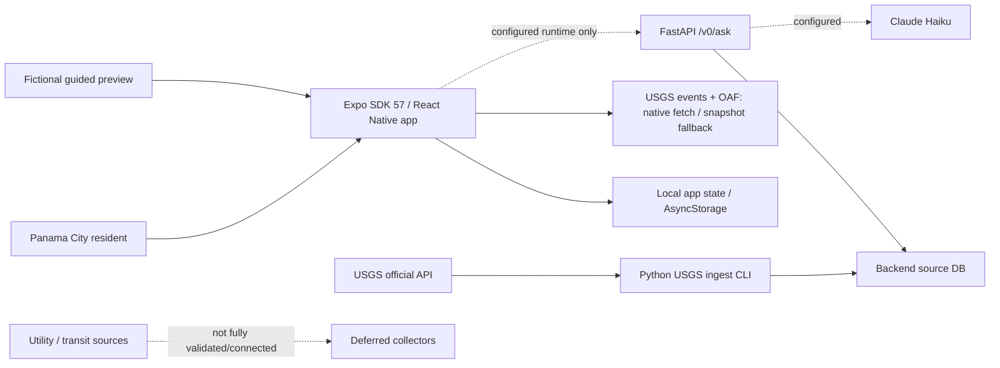
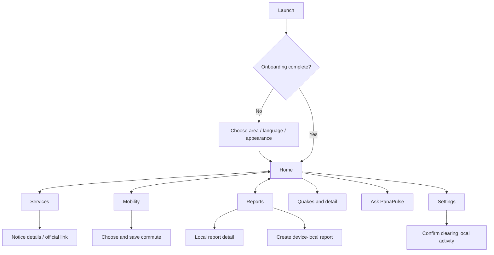
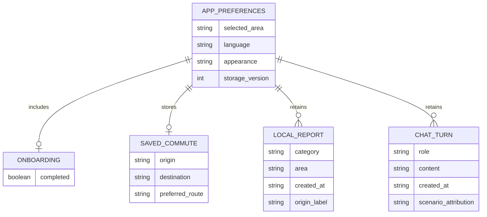
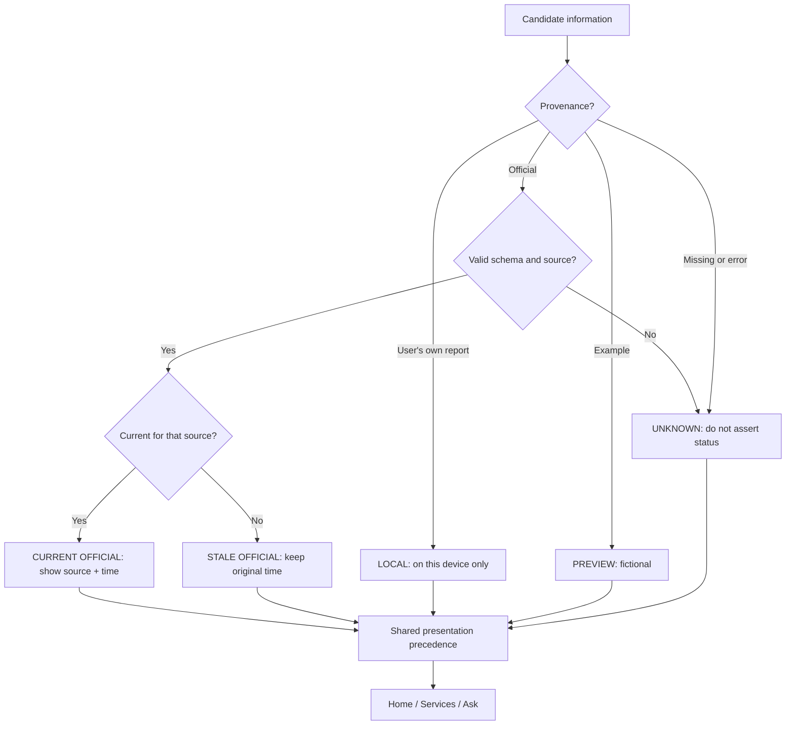
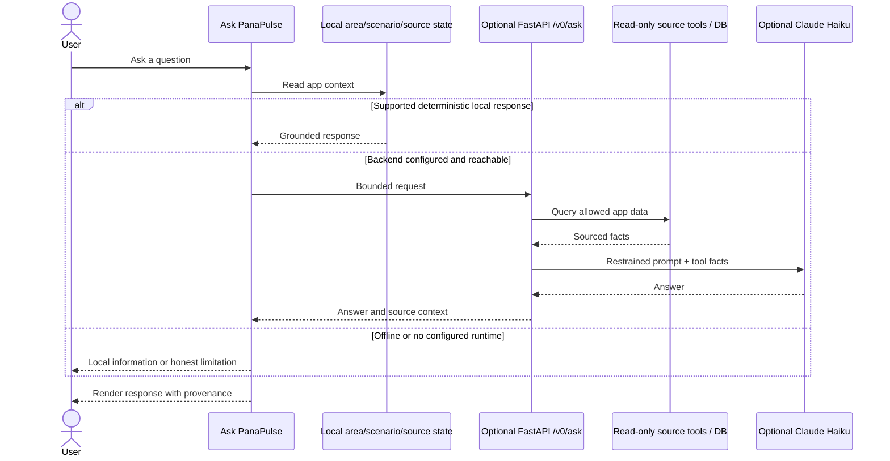
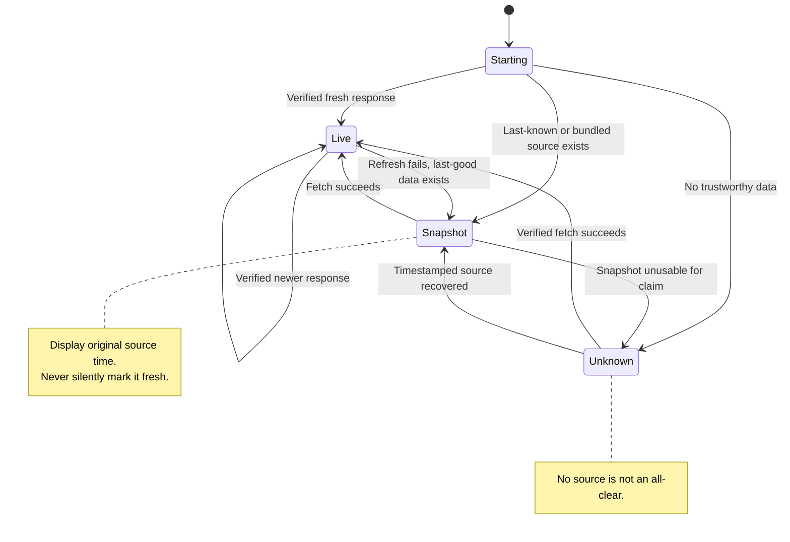
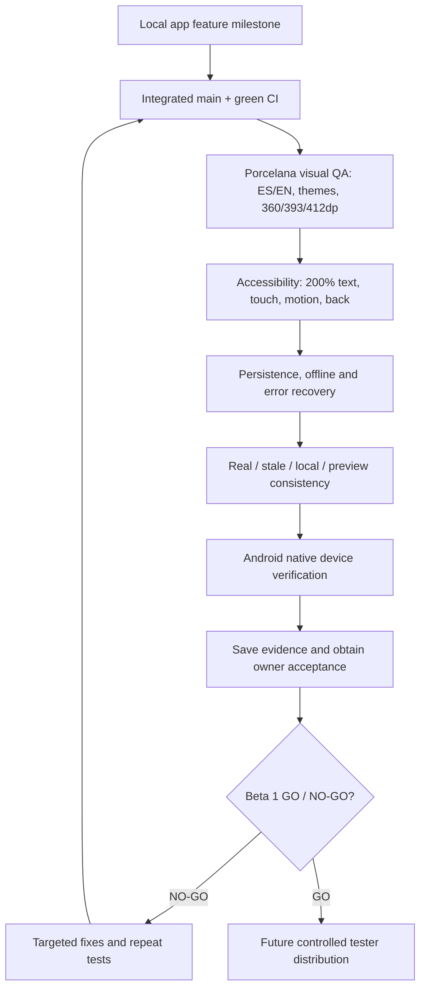

# PanaPulse | Technical Architecture & Product Flows

**Baseline:** October 14, 2026  
**Status:** Living documentation based on `main`, not a Beta 1 release declaration.  
**Sources:** `README.md`, `docs/FEATURE_COMPLETE_HANDOFF.md`, `docs/BETA1_READINESS.md`, `docs/DATA_SOURCES.md`, `backend/README.md`.

These diagrams intentionally distinguish implemented code, validated live operation, local-only data, fictional previews and deferred services. Check the referenced source files before relying on a diagram for implementation details.

## 1. System architecture

**Current boundaries:** The app uses Porcelana branding, Manrope, ES/EN, Auto/Light/Dark, four-tab in-app navigation and typed persisted local data. USGS observations are not earthquake early warning. The Python backend and optional chat runtime exist in code, but this does not establish operational deployment. Reports are device-local, not a public feed. IDAAN, Metro and MiBus real-time integrations are not connected. Scheduled utility notices do not prove current outages. Preserve `DESIGN.md`, `docs/BRAND.md`, `src/theme/tokens.ts`.

## 2. Navigation and user journeys

This is a conceptual flow, not a claim that every destination is a root navigation tab. Actual entry points and back behavior live in `src/App.tsx` and `src/screens/`.

## 3. Conceptual local data model

**Conceptual only:** These are product entities, not verbatim interfaces, SQL tables or guaranteed cardinalities. See `src/data/localModel.ts` and `src/state/AppContext.tsx` for actual persisted types, migrations and reducers.

## 4. Provenance and freshness policy

A genuine current or stale official notice must not be hidden by simulated utility incidents. An announced maintenance window is not confirmation of an outage. An empty feed or failed fetch never means “all clear.” Never infer earthquake warnings, historical OAF probabilities for the present, or live vehicle ETAs. Source-specific freshness rules must come from actual code and provider contracts.

## 5. Assistant request sequence

These are supported/intended paths, not proof that the optional server is live. The README describes four read-only tools and request limits for configured backend chat.

## 6. Offline and recovery states

## 7. Release / verification lifecycle

**Current priority:** local UX and evidence first. No APK/signing, public API hosting, new collectors, monetization or production release is authorized by this documentation.

## Maintenance contract

1. Update Mermaid diagrams in the same PR as a material navigation, schema, source precedence or release-gate change.
2. Clearly differentiate implemented, end-to-end verified, local, simulated and planned.
3. Keep diagrams as text in Markdown to support GitHub rendering and diff reviews.
4. Verify against `src/data/localModel.ts`, `src/state/AppContext.tsx`, `src/screens/`, and `backend/` before using diagrams to generate code.
5. Reconcile this baseline against Claude's subsequent UI changes after they merge.
